# ArithLex: Arithmetic Expression Lexical Analyzer

ArithLex is a **lexical analyzer** (also called a *scanner* or *lexer*) for simple arithmetic statements such as:

```text
total = 12.5 + qty * 2;
```

It was built for the Compilation course at ITC. It reads source text, splits it into **tokens** (the "words" of the language), records the line and column of each token, and reports any character it doesn't recognize as a **lexical error**.

It is written in **Java 25**, and the scanner itself is generated by **JFlex**. You can use it from the console or through a **Swing desktop GUI** (styled with FlatLaf).

> The diagrams below use [Mermaid](https://mermaid.js.org/). GitHub renders them automatically. In VS Code, install the *Markdown Preview Mermaid Support* extension to see them in the preview.

---

## Contents

1. [The big picture: what a lexer does](#1-the-big-picture-what-a-lexer-does)
2. [Where this fits in a compiler](#2-where-this-fits-in-a-compiler)
3. [Project structure](#3-project-structure)
4. [Build time: from `.flex` to running code](#4-build-time-from-flex-to-running-code)
5. [Run time: how one analysis works](#5-run-time-how-one-analysis-works)
6. [Class diagram](#6-class-diagram)
7. [The lexer rules (`ArithLex.flex`)](#7-the-lexer-rules-arithlexflex)
8. [How the scanner reads characters (state machine)](#8-how-the-scanner-reads-characters-state-machine)
9. [Building and running](#9-building-and-running)
10. [Full example](#10-full-example)
11. [The GUI](#11-the-gui)
12. [Behaviors and limitations](#12-behaviors-and-limitations)
13. [How to extend it](#13-how-to-extend-it)
14. [Tech stack](#14-tech-stack)

---

## 1. The big picture: what a lexer does

A lexer reads a line of characters and groups them into meaningful pieces called **tokens**. It throws away whitespace, and it notes where every token starts.

```text
 Input characters:   t o t a l   =   1 2 . 5   +   q t y   *   2 ;
                     └───┬───┘   │   └──┬──┘   │   └─┬─┘   │   │ │
                         │       │      │      │     │     │   │ │
 Tokens:            IDENTIFIER ASSIGN DECIMAL  ARITH IDENT ARITH INT SEMICOLON
                      "total"   "="   "12.5"  "+"  "qty"  "*"  "2"  ";"
 Column:                 1       7      9      14    16    20   22  23
```

Each token has four parts:

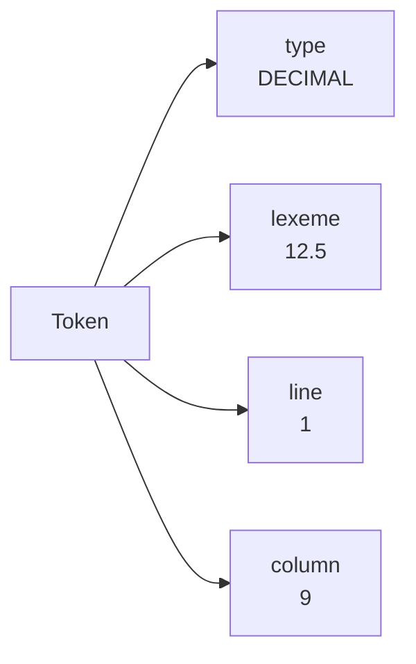

If the lexer finds a character that isn't part of the language, it doesn't crash. It records an **error** and keeps going:

```text
 Input:   p r i c e   =   1 0 0   @   5 ;
                                  ▲
                                  └── '@' is not a valid character
                                      → "Unexpected character '@' at Line 4, Column 13"
```

---

## 2. Where this fits in a compiler

A compiler works in stages. This project covers **only the first stage**.

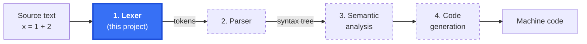

The dashed stages are **not** part of this project.

The lexer only answers *"what is each piece of text?"*. It does **not** check whether the pieces are in a valid order:

| Input | Lexer (this project) | Parser (not built) |
| --- | --- | --- |
| `x = 1 + 2;` | OK: `IDENTIFIER ASSIGN INTEGER ARITHMETIC_OP INTEGER SEMICOLON` | OK |
| `price = 100 5;` | OK: `IDENTIFIER ASSIGN INTEGER INTEGER SEMICOLON` | Error: two numbers in a row |
| `price = 100 @ 5;` | Error: `@` is an unknown character | (never reached) |

---

## 3. Project structure

```text
Arithmetic-input-scanner/
├── pom.xml                              Maven build: Java 25, JFlex plugin, FlatLaf, JUnit
├── input/
│   └── sample.txt                       Example input read by the console app
└── src/
    ├── main/
    │   ├── jflex/
    │   │   └── ArithLex.flex            ★ The lexer rules (token definitions)
    │   └── java/edu/itc/arithlex/
    │       ├── Token.java               A recognized token: type, lexeme, line, column
    │       ├── LexicalError.java        An unrecognized character and its position
    │       ├── LexerResult.java         Holds the token list and the error list
    │       ├── LexerService.java        Runs the scanner and sorts tokens from errors
    │       ├── App.java                 Console entry point
    │       └── ArithLexGUI.java         Swing GUI entry point
    └── test/java/edu/itc/arithlex/
        └── AppTest.java                 Placeholder test (always passes)
```

How the files depend on each other:

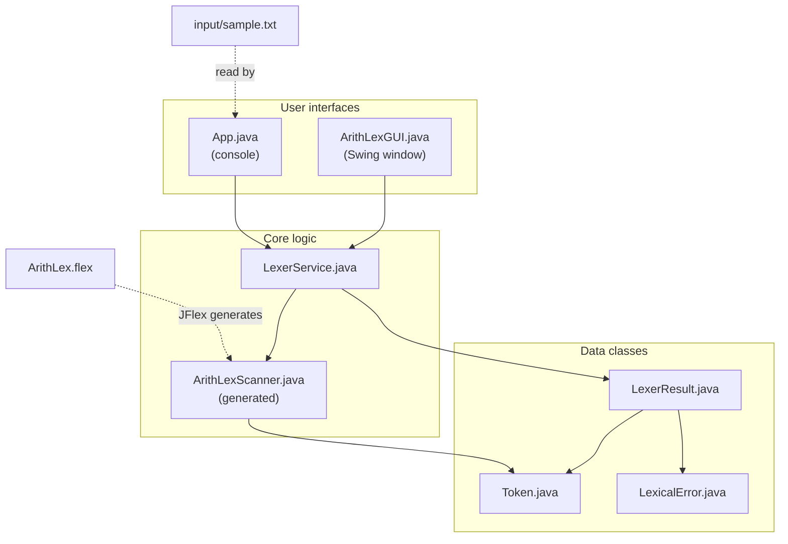

---

## 4. Build time: from `.flex` to running code

`ArithLexScanner.java` is **not** in `src/`. Maven generates it from `ArithLex.flex` every time you build.

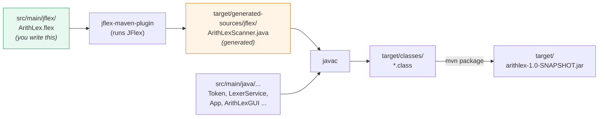

> **Rule of thumb:** never edit `ArithLexScanner.java` by hand. Your changes would be overwritten on the next build. Edit `ArithLex.flex` and rebuild.

---

## 5. Run time: how one analysis works

### Step by step

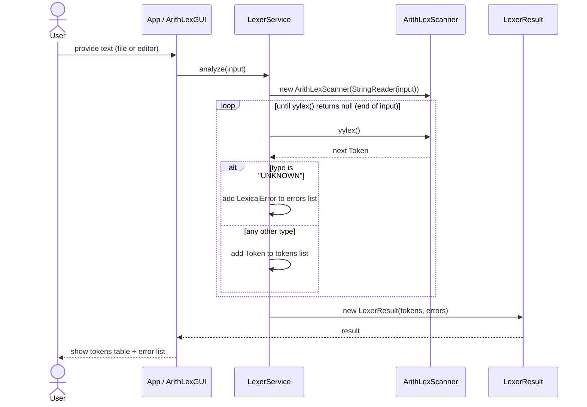

### The decision inside `LexerService`

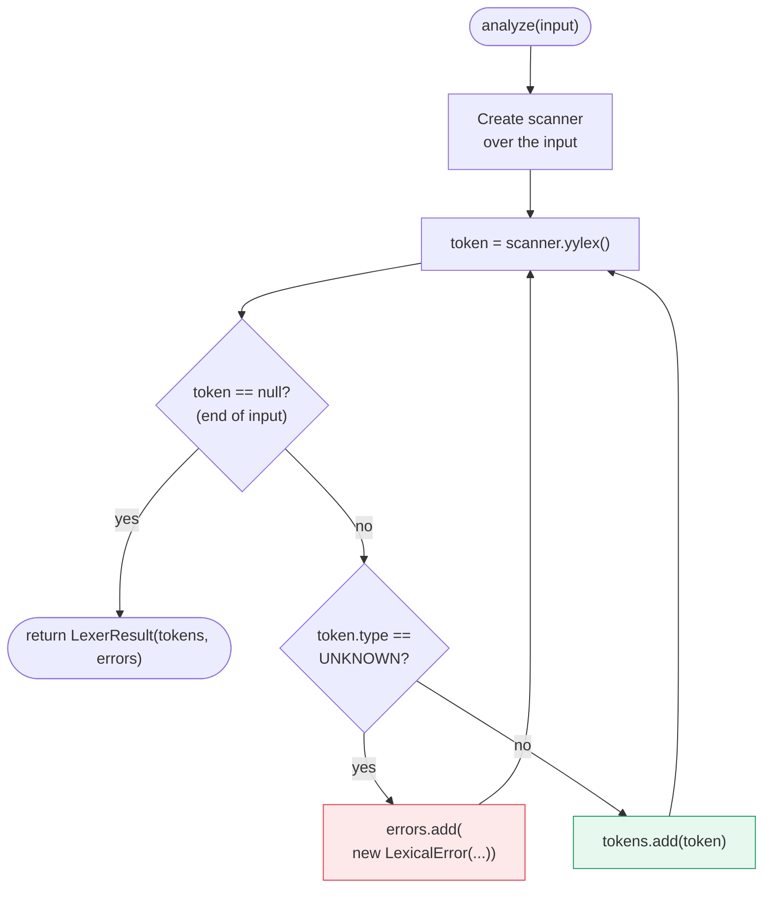

The key design idea: the scanner **never throws on bad input**. It returns an `UNKNOWN` token and continues, so one run reports **all** errors instead of stopping at the first one.

---

## 6. Class diagram

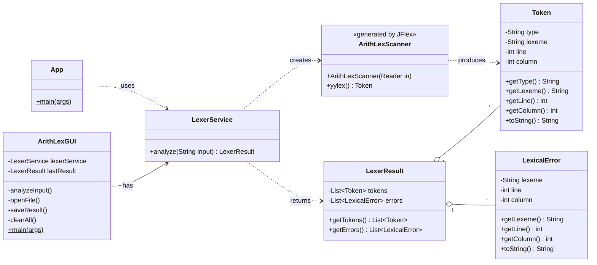

---

## 7. The lexer rules (`ArithLex.flex`)

A JFlex file has three sections separated by `%%`:

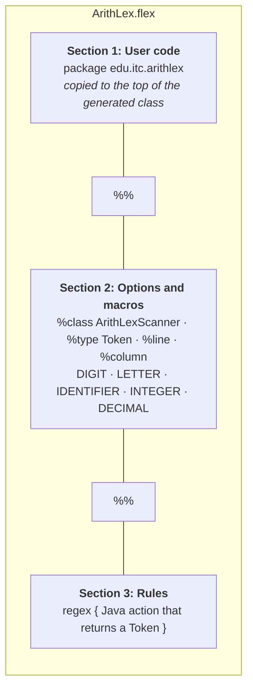

### Macros

```text
DIGIT      = [0-9]
LETTER     = [a-zA-Z_]
IDENTIFIER = {LETTER}({LETTER}|{DIGIT})*     e.g. total, qty, _x1
INTEGER    = {DIGIT}+                        e.g. 2, 100, 2888
DECIMAL    = {DIGIT}+"."{DIGIT}+             e.g. 12.5, 0.75
```

### Token types

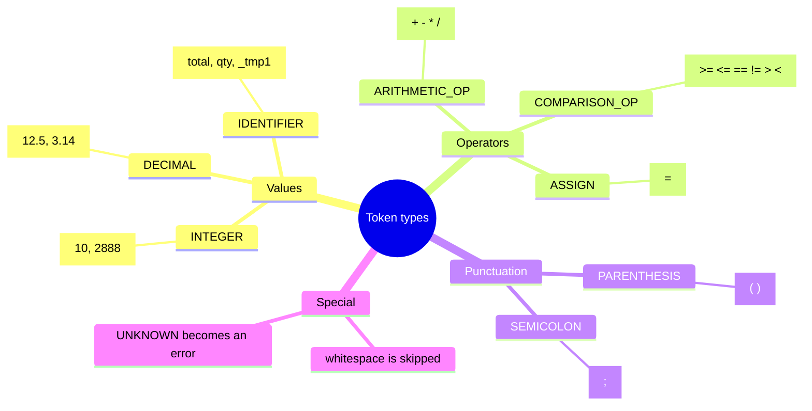

| Token type | Matches | Examples |
| --- | --- | --- |
| `DECIMAL` | digits `.` digits | `12.5`, `3.14` |
| `INTEGER` | one or more digits | `10`, `2888` |
| `IDENTIFIER` | letter/underscore, then letters/digits/underscores | `total`, `qty`, `_tmp1` |
| `COMPARISON_OP` | `>=` `<=` `==` `!=` `>` `<` | `x >= 5` |
| `ASSIGN` | `=` | `x = 1` |
| `ARITHMETIC_OP` | `+` `-` `*` `/` | `a + b` |
| `PARENTHESIS` | `(` `)` | `(10 + 5)` |
| `SEMICOLON` | `;` | end of a statement |
| *(skipped)* | spaces, tabs, newlines | none (no token is produced) |
| `UNKNOWN` → **error** | `.` (any other single character) | `@`, `#`, `$`, `%` |

### How JFlex chooses a rule

When more than one rule could match, JFlex uses two rules of its own:

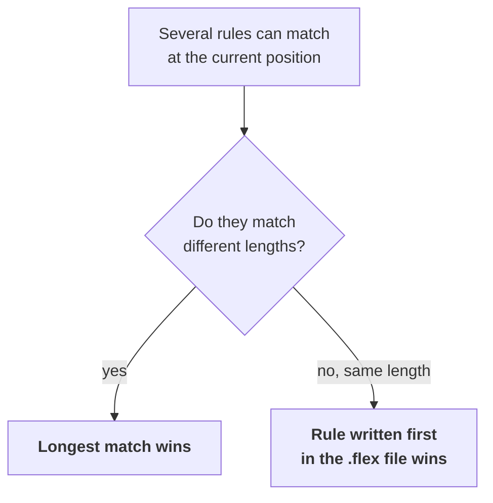

**Longest match** examples:

```text
 Input "12.5":
   INTEGER  matches  "12"     (2 chars)
   DECIMAL  matches  "12.5"   (4 chars)  ◄── wins
   → one DECIMAL token, not INTEGER + error + INTEGER

 Input "==":
   ASSIGN         matches  "="    (1 char)
   COMPARISON_OP  matches  "=="   (2 chars)  ◄── wins
```

**First rule wins** example: the catch-all `.` rule matches any single character, so it's placed **last**. That way it only applies when nothing else matches.

`yyline` and `yycolumn` start at 0 in JFlex, so every action adds `+ 1` to report 1-based positions, the way editors count them.

---

## 8. How the scanner reads characters (state machine)

JFlex turns the regular expressions into a **finite automaton (DFA)**. Here is a simplified picture of how it recognizes numbers and identifiers one character at a time:

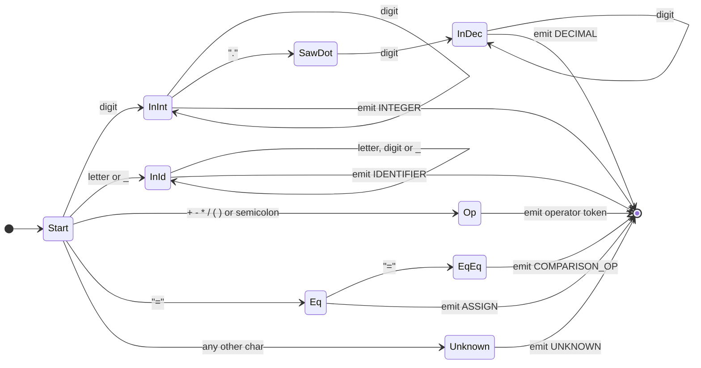

The scanner keeps reading while the next character keeps it in a valid state. When it can't go further, it emits the longest token it has seen. For example, with `12.`, the scanner reaches `SawDot`, but no digit follows. So it falls back to the last good token, `INTEGER(12)`, and the `.` then becomes an `UNKNOWN` error.

---

## 9. Building and running

### Requirements

- **JDK 25** (the `pom.xml` sets `maven.compiler.release` to 25)
- **Maven 3.x**

Run every command from the `Arithmetic-input-scanner/` folder.

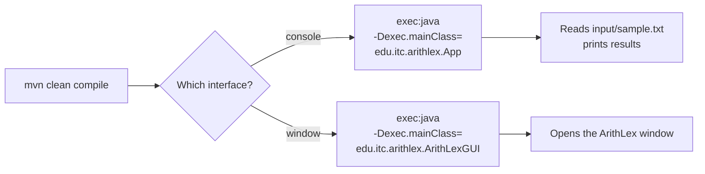

### Build

```bash
mvn clean compile        # generates ArithLexScanner.java from the .flex file, then compiles
mvn package              # also builds target/arithlex-1.0-SNAPSHOT.jar
```

### Run the console version

This reads `input/sample.txt` (a relative path, so run it from the project root):

```bash
mvn -q compile exec:java -Dexec.mainClass=edu.itc.arithlex.App
```

### Run the GUI

```bash
mvn -q compile exec:java -Dexec.mainClass=edu.itc.arithlex.ArithLexGUI
```

### Run tests

```bash
mvn test
```

---

## 10. Full example

**Input** (`input/sample.txt`):

```text
total = 12.5 + qty * 2;
result = (10 + 5) / 3;
average = total / count;
price = 100 @ 5;
discount = 20 # 2;
x=2888;
```

What happens to each line:

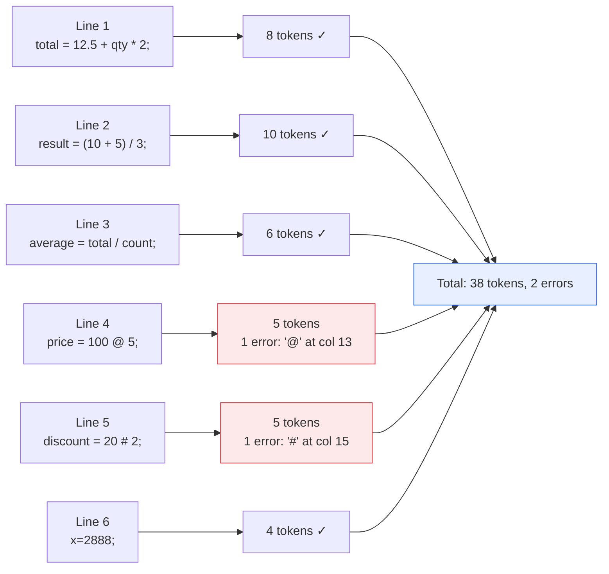

**Console output** (shortened):

```text
LEXICAL ANALYSIS RESULTS
----------------------------------------------
IDENTIFIER: total | Line: 1 | Column: 1
ASSIGN: = | Line: 1 | Column: 7
DECIMAL: 12.5 | Line: 1 | Column: 9
ARITHMETIC_OP: + | Line: 1 | Column: 14
IDENTIFIER: qty | Line: 1 | Column: 16
ARITHMETIC_OP: * | Line: 1 | Column: 20
INTEGER: 2 | Line: 1 | Column: 22
SEMICOLON: ; | Line: 1 | Column: 23
...
IDENTIFIER: x | Line: 6 | Column: 1
ASSIGN: = | Line: 6 | Column: 2
INTEGER: 2888 | Line: 6 | Column: 3
SEMICOLON: ; | Line: 6 | Column: 7

LEXICAL ERRORS
----------------------------------------------
Unexpected character '@' at Line 4, Column 13
Unexpected character '#' at Line 5, Column 15
----------------------------------------------
Total tokens: 38
Total errors: 2
```

Notice that `x=2888;` works without spaces. The lexer separates tokens by their patterns, not by whitespace.

---

## 11. The GUI

### Window layout

```text
┌──────────────────┬─────────────────────────────────────────────────────────────┐
│ ⌘ ArithLex       │  Arithmetic Expression Analyzer                  ● Ready    │
│ Lexical Analyzer │  Analyze the lexical structure of your expressions.         │
│                  │                                                             │
│ ▣ Workspace      │  Input Expression          Enter an expression or open .txt │
│ ▤ Documentation  │  ┌───┬───────────────────────────────────────────────────┐  │
│ ⓘ About ArithLex │  │ 1 │ total = 12.5 + qty * 2;                           │  │
│                  │  │ 2 │ result = (10 + 5) / 3;                            │  │
│                  │  │ 3 │ ...                                               │  │
│                  │  └───┴───────────────────────────────────────────────────┘  │
│                  │  [▶ Analyze] [Clear]              [Open File] [Save Result] │
│                  │                                                             │
│                  │  Analysis Results                    Tokens: 38  Errors: 2  │
│                  │  ┌──────────────────────────────────┐ ┌──────────────────┐  │
│                  │  │ Token Type │ Lexeme │ Line │ Col │ │ ⚠ Lexical Errors │  │
│                  │  │ IDENTIFIER │ total  │  1   │  1  │ │                  │  │
│                  │  │ ASSIGN     │ =      │  1   │  7  │ │ ● Unexpected '@' │  │
│ VERSION 1.0.0    │  │ DECIMAL    │ 12.5   │  1   │  9  │ │   Line 4, Col 13 │  │
│ Java • JFlex     │  │ ...        │        │      │     │ │ ● Unexpected '#' │  │
│                  │  └──────────────────────────────────┘ └──────────────────┘  │
└──────────────────┴─────────────────────────────────────────────────────────────┘
     Sidebar                            Workspace
```

### What each button does

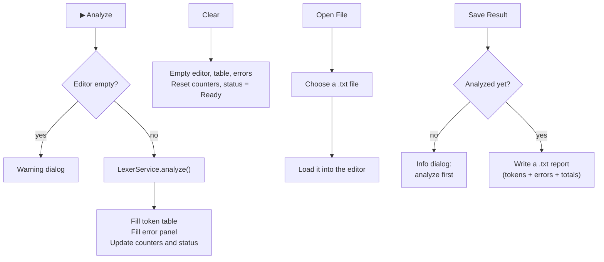

### Status badge

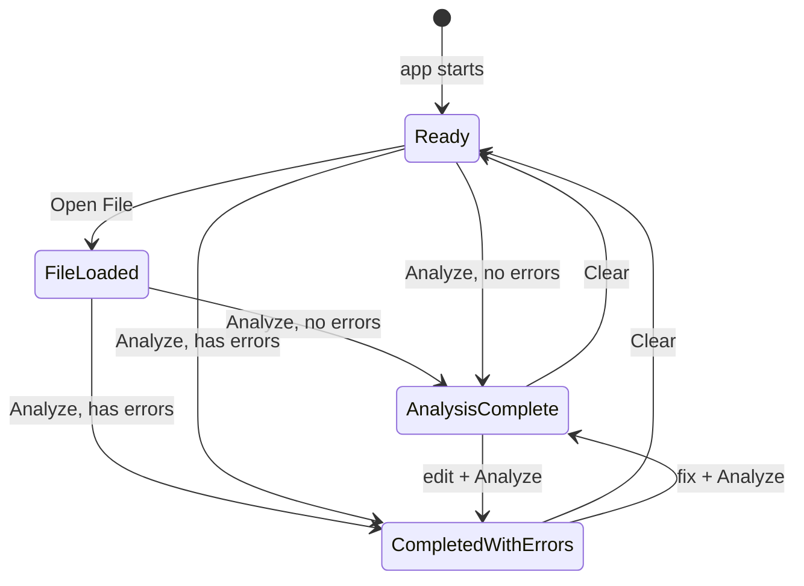

The *Workspace* sidebar button is decorative. *Documentation* and *About* open info dialogs.

---

## 12. Behaviors and limitations

These are consequences of the current rules, useful to know when testing or extending the lexer:

| Input | What happens | Why |
| --- | --- | --- |
| `-5` | `ARITHMETIC_OP(-)`, `INTEGER(5)` | The lexer has no concept of negative numbers. A parser would treat this as unary minus. |
| `12.` | `INTEGER(12)`, then error on `.` | `DECIMAL` requires digits on both sides of the dot (see the state machine in section 8). |
| `.5` | error on `.`, then `INTEGER(5)` | Same reason. |
| `3abc` | `INTEGER(3)`, `IDENTIFIER(abc)` | Not a lexical error. A parser would reject it. |
| `!` alone | error | Only `!=` is defined. |
| `%`, `^` | error | Modulo and power operators aren't defined. |
| `price = 100 5;` | no errors | The lexer doesn't check grammar (see section 2). |

Other notes:

- Token types are plain `String`s (`"INTEGER"`, `"UNKNOWN"`, …), not an `enum`.
- `AppTest` is the default Maven archetype placeholder. It doesn't test the lexer yet.
- `App` hard-codes the path `input/sample.txt`.

---

## 13. How to extend it

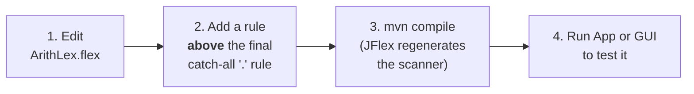

**Add a new operator** (for example, `%` for modulo): change

```text
"+" | "-" | "*" | "/"
```

to

```text
"+" | "-" | "*" | "/" | "%"
```

**Add keywords** (for example, `if` and `while`): put a rule such as `"if" { return new Token("KEYWORD", ...); }` **before** the `{IDENTIFIER}` rule. Both rules match `if` with the same length, so the rule written first wins (see section 7).

---

## 14. Tech stack

| Tool | Version | Role |
| --- | --- | --- |
| Java | 25 | Language |
| Maven | 3.x | Build tool |
| JFlex (`jflex-maven-plugin`) | 1.9.1 | Generates the scanner from `ArithLex.flex` |
| FlatLaf | 3.6.2 | Modern look-and-feel for the Swing GUI |
| JUnit | 4.13.2 | Testing |
